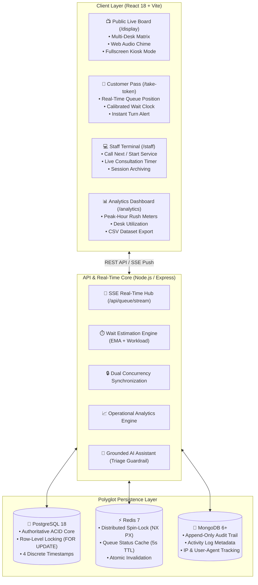

# Quebee — Smart Queue & Service-Time Optimization Platform

<p align="center">
  
  
  
  
  
</p>

<p align="center">
  <strong>"Smart queues. Better experiences"</strong><br>
  Built under academic & hackathon engineering specification: <strong>PS-13 — Smart Queue and Service-Time Optimization Platform</strong>
</p>

---

## 📌 1. Project Overview & The Problem Solved

Traditional queue systems rely on static paper tickets and verbal announcements, leaving visitors frustrated with zero visibility into waiting times, while operations staff remain unaware of peak demand spikes and counter bottlenecks.

**Quebee** is an intelligent, high-concurrency universal queue management platform. It eliminates congestion through:
- **Zero-Duplicate Concurrency Locking:** Guaranteed gapless, sequential tokens across independent services (`A-1`, `B-2`) under burst load.
- **Calibrated Wait-Time Estimation:** Algorithmic workload modeling paired with Exponential Moving Averages (EMA) of real historical consultation times.
- **Instant Real-Time Synchronization:** Server-Sent Events (SSE) push streaming to public display boards, customer mobile passes, and staff terminals without manual page refreshing.
- **Operational Bottleneck Analytics:** Hourly arrival distributions, wait-vs-service duration variance, and automated staffing recommendations.
- **Privacy-Safe Healthcare Urgency Guardrail:** Triage urgency tiers under human supervision, with an explainable AI Assistant strictly prohibited from making independent clinical diagnoses.

---

## 🎯 2. PS-13 Official Compliance Matrix

| # | Official PS-13 Expected Outcome | Quebee Technical Implementation | Compliance Status |
| :---: | :--- | :--- | :---: |
| **1** | **Digital Queue Token Generation** | Dual-layer concurrency lock (Redis distributed spin-lock `SET NX PX` + PostgreSQL row lock `FOR UPDATE` on `service_token_sequences`). Supports multi-service routing, priority tiers, cancellation, and walk-in tokens. | **100% Verified** |
| **2** | **Waiting-Time Estimation** | Mathematical queue engine calibrated by empirical Exponential Moving Averages (EMA) of actual `(completed_at - started_at)` intervals. Includes confidence ratings and estimation disclaimers. | **100% Verified** |
| **3** | **Queue Status & Progress Dashboard** | Real-time push via Server-Sent Events (`/api/queue/stream`), multi-desk digital board with synthesized Web Audio chimes, mobile ticket pass, and staff terminal with consultation timer. | **100% Verified** |
| **4** | **Peak-Hour & Bottleneck Identification** | Operations analytics tracking hourly arrival distribution meters, wait-vs-service time variance benchmarks, counter utilization, and congestion alerts. | **100% Verified** |
| **5** | **Service Analytics & Efficiency Recommendations** | Data-driven staffing recommendations, one-click complete CSV dataset export (`/api/analytics/export`), and an explainable, grounded AI Queue Assistant. | **100% Verified** |

---

## 🏛️ 3. System Architecture



---

## ⏱️ 4. Accurate 4-Timestamp Lifecycle Model

Quebee records four discrete timestamps for every token to accurately measure customer wait time versus counter consultation time:

```
[issued_at] ────────► [called_at] ────────► [started_at] ────────► [completed_at]
     │                      │                      │                       │
     │                      │                      │                       │
Customer joins        Staff calls token      Customer arrives at     Staff completes
digital queue         to active desk         desk; stopwatch starts  service at desk
                      └──────┬──────┘        └──────────┬─────────┘  └───────┬───────┘
                             │                          │                    │
                      Customer Wait Time         Desk Arrival Delay    Service Duration
                    (called - issued)           (started - called)   (completed - started)
```

- **Lounge Wait Time:** `called_at - issued_at`
- **Call-to-Desk Delay:** `started_at - called_at`
- **Actual Consultation Duration:** `completed_at - started_at` (used by the EMA engine to predict future wait times).

---

## 🔒 5. High-Concurrency Token Generation Architecture

Under burst load (e.g. 20+ visitors requesting tokens simultaneously), Quebee guarantees **zero duplicate token numbers** and **gapless sequences**:

1. **Redis Distributed Spin-Lock:**
   ```javascript
   // Distributed mutual exclusion across multi-process clusters with spin-wait retry
   redis.set('queue:token_issue_lock', lockValue, 'PX', 5000, 'NX');
   ```
2. **PostgreSQL Row-Level Transactional Lock:**
   ```sql
   -- Strict row lock inside transaction guarantees gapless serialization
   SELECT last_number FROM service_token_sequences WHERE service_id = $1 FOR UPDATE;
   UPDATE service_token_sequences SET last_number = last_number + 1 WHERE service_id = $1;
   ```
3. **Non-Blocking Counter Advancement:**
   ```sql
   -- Staff calling next token locks only the top waiting record without blocking other desks
   SELECT id FROM tokens WHERE status = 'waiting' ORDER BY priority DESC, id ASC LIMIT 1 FOR UPDATE SKIP LOCKED;
   ```

---

## 🖥️ 6. Dashboard Capabilities

### 1. Public Live Display Board (`/display`)
- High-contrast multi-counter grid showing all active desks and current numbers.
- **Standing By Mode:** Automatically displays clean standby state when all desks are idle.
- **Synthesized Web Audio Chime:** Pure browser-synthesized two-tone bell chime (`D5 ➔ A5`) with zero external audio dependencies.
- **Fullscreen Mode:** One-click kiosk mode for lobby wall monitors.

### 2. Customer Mobile Ticket (`/take-token`)
- Select from configured organization services (General Intake, Express, Specialist).
- Urgency tier selection (Standard, Priority / Accessible, Urgent).
- Calibrated wait range (e.g. `~1–3 mins`, `4 customers ahead`) with official PS-13 disclaimer.
- Live call notification banner directing the visitor to their specific desk.
- Self-service cancellation.

### 3. Staff Terminal (`/staff`)
- Multi-counter switcher (Desk 1, Desk 2, Desk 3).
- Step-by-step queue controls: *Call Next* ➔ *Start Consultation* ➔ *Complete* (or *Skip / No-Show*).
- **Live Consultation Stopwatch:** Real-time elapsed timer (`mm:ss`) measuring desk consultation speed.
- **Non-Destructive Session Reset:** Safely archives the current session into `queue_sessions` and resets daily counters without deleting historical records.

### 4. Operations Analytics & Bottlenecks (`/analytics`)
- **Hourly Rush Meters:** Visual arrival volume distribution identifying operational peak hours.
- **Wait vs. Service Time Benchmarks:** Side-by-side comparison of customer wait time vs. service handling time.
- **Desk Utilization Table:** Performance breakdown across active desks.
- **Algorithmic Staffing Recommendations:** Real-time staffing guidance based on wait variance and queue length.
- **One-Click CSV Export:** Download full audit spreadsheets containing all 4 timestamps for external reporting.

### 5. Floating AI Queue Assistant
- Grounded conversational assistant answering visitor FAQs and queue position questions.
- **Healthcare Clinical Guardrail:** Automatically detects acute medical symptoms (e.g., chest pain, shortness of breath) and strictly refuses medical diagnosis, directing the patient to emergency triage or 911.

---

## 🚀 7. Quickstart & Local Installation

### Prerequisites
- Node.js 18+ (tested up to Node 24)
- PostgreSQL 18
- Redis 7
- MongoDB 6+

### Step 1: Clone Repository
```bash
git clone https://github.com/yashaachar/smart-queue-mangement.git
cd smart-queue-mangement/queue-system
```

### Step 2: Configure Environment
Copy the example environment template in `backend`:
```bash
cd backend
cp .env.example .env
npm install
npm run db:migrate        # Runs PostgreSQL relational migrations & seed data
```

### Step 3: Start Application Servers
In terminal 1 (Backend API):
```bash
cd queue-system/backend
npm run dev               # Runs on http://localhost:5000
```

In terminal 2 (Frontend Client):
```bash
cd queue-system/frontend
npm install
npm run dev               # Runs on http://localhost:3000
```

---

## 🧪 8. Automated Testing & Verification

### Concurrency Stress Test (PS-13 Outcome 1)
Fires 16 simultaneous burst requests across different services to verify zero race conditions and gapless numbering:
```bash
cd queue-system/backend
npm run test:concurrency
```

### Pristine Database Reset (For Demo Evaluations)
Resets the database to a clean slate, resetting counters to 0 and re-creating default demo accounts:
```bash
cd queue-system/backend
npm run db:reset:clean
```

---

## 🔑 9. Pre-Configured Demo Credentials

| Role | Email | Password | Access Rights |
| :--- | :--- | :--- | :--- |
| **Staff Operator** | `staff1@test.com` | `pass123` | Staff Terminal, Analytics Dashboard, Audit Logs |
| **Visitor 1** | `patient1@test.com` | `pass123` | Take Token, Mobile Ticket Pass, Cancellation |
| **Visitor 2** | `patient2@test.com` | `pass123` | Multi-user queue testing |
| **Public Display** | *(No login)* | — | [http://localhost:3000/display](http://localhost:3000/display) |

---

## 📡 10. Complete API Reference

### Authentication
- `POST /api/auth/register` — Register customer or staff account.
- `POST /api/auth/login` — Sign in and receive JWT.
- `GET /api/auth/me` — Retrieve current authenticated profile.

### Digital Tokens (PS-13 Outcome 1)
- `POST /api/tokens/generate` — Generate sequential token with dual-layer concurrency protection.
- `GET /api/tokens/my` — Fetch caller's active ticket and calibrated wait estimate.
- `GET /api/tokens` *(Staff)* — Paginated token ledger with status and service filters.
- `POST /api/tokens/:id/cancel` — Cancel waiting token.

### Real-Time Streaming & Queue Controls (PS-13 Outcomes 2 & 3)
- `GET /api/queue/stream` — **Server-Sent Events (SSE)** real-time push stream with heartbeats.
- `GET /api/queue/status` — Cached operational queue snapshot.
- `POST /api/queue/next` *(Staff)* — Call next waiting token to an active desk (`called_at = NOW()`).
- `POST /api/queue/start-serving` *(Staff)* — Start consultation stopwatch (`started_at = NOW()`).
- `POST /api/queue/complete` *(Staff)* — Complete consultation (`completed_at = NOW()`).
- `POST /api/queue/skip` *(Staff)* — Mark token as skipped / no-show.
- `POST /api/queue/reset` *(Staff)* — Non-destructive session archiving.
- `PATCH /api/queue/toggle` *(Staff)* — Open or close queue intake.

### Operational Analytics & AI (PS-13 Outcomes 4 & 5)
- `GET /api/analytics` *(Staff)* — Hourly volume distribution, wait-vs-service benchmarks, and staffing recommendations.
- `GET /api/analytics/export` *(Staff)* — Download complete token audit dataset in CSV format.
- `POST /api/ai/chat` — Grounded customer queue assistant with clinical emergency guardrails.
- `GET /api/ai/insights` *(Staff)* — Operational bottleneck digest.

---

## 📄 License & Academic Attribution
Developed under specification **PS-13: Smart Queue and Service-Time Optimization Platform**.  
Repository: [https://github.com/yashaachar/smart-queue-mangement.git](https://github.com/yashaachar/smart-queue-mangement.git)  
Copyright © 2026 Quebee. All rights reserved.
